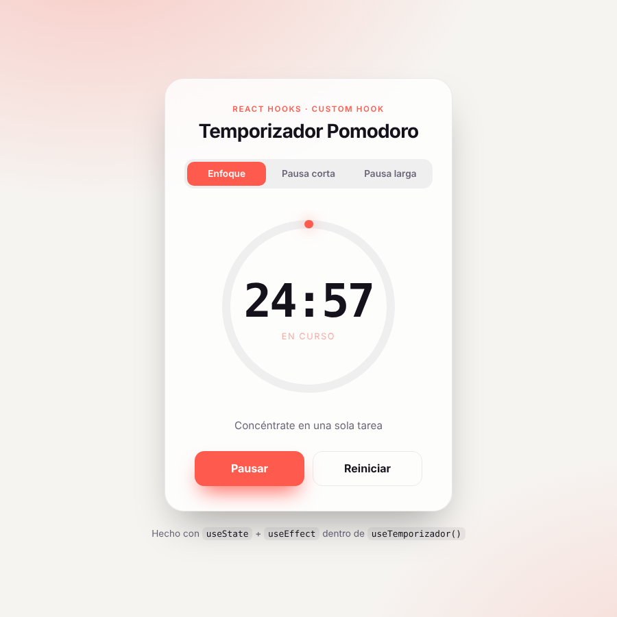
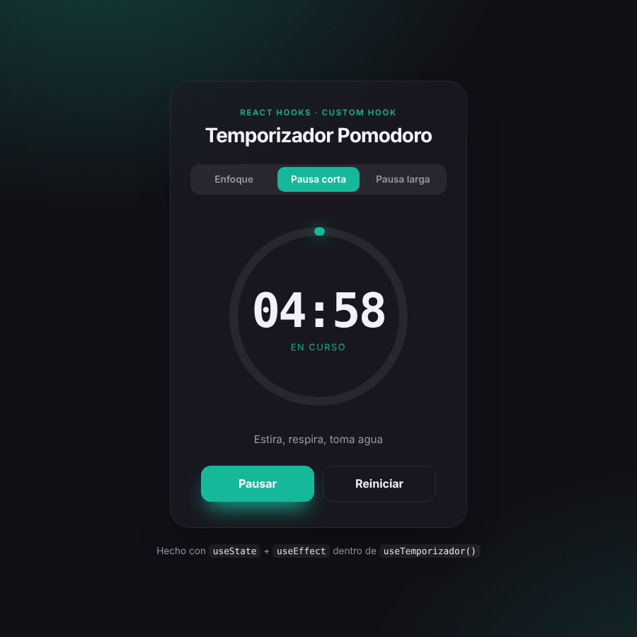

# ⏳ Temporizador Pomodoro — React Hooks

Aplicación hecha con **React + Vite** para practicar **Hooks** y la creación de un **Custom Hook**.
Es un temporizador de cuenta regresiva basado en la técnica Pomodoro, con tres modos:

| Modo         | Duración |
| ------------ | -------- |
| Enfoque      | 25 min   |
| Pausa corta  | 5 min    |
| Pausa larga  | 15 min   |

| Modo claro | Modo oscuro |
| --- | --- |
|  |  |

## 🎯 Objetivo

Separar la **lógica** del **diseño**:

- `useTemporizador` (custom hook) guarda el estado y maneja el tiempo.
- `Temporizador` (componente) solo muestra la información y llama a las acciones del hook.

## 🪝 Hooks utilizados

| Hook        | Dónde                 | Para qué                                                                 |
| ----------- | --------------------- | ------------------------------------------------------------------------ |
| `useState`  | `useTemporizador`     | Guardar la duración, los segundos restantes y si está en marcha          |
| `useEffect` | `useTemporizador`     | Crear el `setInterval` cuando está activo y limpiarlo con `clearInterval` (se detiene solo al llegar a `00:00`) |
| `useEffect` | `useTemporizador`     | Mostrar el tiempo restante en el título de la pestaña                    |
| `useState`  | `Temporizador`        | Guardar el modo seleccionado (Enfoque / Pausa corta / Pausa larga)       |

### ¿Qué devuelve `useTemporizador`?

```js
const {
  segundosRestantes, // número de segundos que faltan
  duracion,          // duración total en segundos
  activo,            // true si está corriendo
  terminado,         // true cuando llega a 0
  progreso,          // valor de 0 a 1 (para el anillo)
  formatoTiempo,     // texto "mm:ss"
  alternar,          // iniciar / pausar
  reiniciar,         // volver al inicio del modo actual
  cambiarDuracion,   // cambiar los minutos del temporizador
} = useTemporizador(25);
```

## 📁 Estructura

```
src/
├── components/
│   ├── Temporizador.jsx   # Interfaz (vista)
│   └── Temporizador.css   # Estilos del componente
├── hooks/
│   └── useTemporizador.jsx  # Custom Hook (lógica)
├── App.jsx
├── index.css
└── main.jsx
```

## 🚀 Cómo ejecutarlo

```bash
npm install
npm run dev
```

Abrir la URL que muestra la terminal (por defecto `http://localhost:5173`).

Otros comandos:

```bash
npm run build    # Genera la versión de producción en /dist
npm run preview  # Previsualiza el build
npm run lint     # Revisa el código con oxlint
```

## 🛠️ Tecnologías

- React 19
- Vite
- Oxlint

---

Autor: **Miguel Ángel Sabogal Maldonado** — Ingeniería de Sistemas, Universidad Distrital Francisco José de Caldas.
